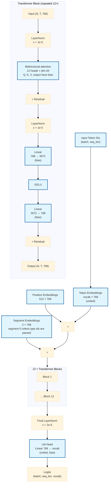

# bert-base Architecture

The `bert_base` preset in the `llm` library (`llm::presets::bert_base`) defines an encoder Transformer with the GPT-2 dense block and BERT's attention pattern: learned absolute positions, a segment table, pre-norm LayerNorm, bidirectional attention, and a GELU MLP of width `4 * d_model`.

## Specs

| Spec | Value |
|------|-------|
| Layers (`num_layers`) | 12 |
| Model dimension (`d_model`) | 768 |
| Attention heads (`num_heads`) | 12 (head dim = 64) |
| Feed-forward intermediate (`d_ff`) | 3072 (GELU; fc1 writes 3072, not 6144) |
| Max sequence length | 512 |
| Positional encoding | learned absolute (`pos_emb`, 512 × 768) |
| Segment embeddings | `type_emb`, 2 × 768. `forward(tokens)` uses segment 0 |
| Normalization | LayerNorm, epsilon `1e-5` |
| Activation | GELU, the erf form (`0.5 * x * (1 + erf(x / sqrt(2)))`), not the tanh approximation |
| Attention | bidirectional (`causal` false). Every token attends to the whole sequence |
| Bias | true, on Q, K, V, the attention output, both MLP linears, and the LM head |
| Tie embeddings | false (`nn` rejects `tie_embeddings`) |
| Dropout | 0 |
| Parameter count (untied, vocab ≈ 16000) | 110,042,752 (~110.04 M) |

These match the values returned by `llm::presets::bert_base(vocab_size)` and the counts documented in the README / USAGE.md. `bert_tiny` is 4 × 256 with `d_ff` 1024. `bert_small` is 6 × 512 with `d_ff` 2048. Both keep context 512 and a segment table of size 2.

`train_books --preset bert-base` trains masked tokens and saves a version-6 checkpoint (AdamW). `save(path, nullptr)` of the same shape is version 5. The mask id is the tokenizer pad id. This library's byte-level BPE has no `<mask>` piece and does not insert pad during `encode`. Of the positions chosen for the loss (15% by default), 80% become that pad id, 10% become a random id, and 10% keep the original id. Other positions use ignore index `-100`.

This is the block to train from scratch. It does not load published BERT weights. There is no WordPiece tokenizer, no next-sentence pooler, and no sentence-pair corpus format. `forward(tokens, type_ids)` is the hook for a later pair of segments. `chat` and `Generator` refuse this checkpoint. `gguf llama` rejects bidirectional attention and a segment table.

## Architecture Diagram

The diagram shows the data flow for a forward pass. Token embeddings, learned position embeddings, and segment embeddings are added, then each of the 12 identical blocks applies pre-norm LayerNorm → bidirectional attention → residual, then pre-norm LayerNorm → GELU MLP → residual. There is no causal mask, no RoPE, and no RMSNorm. Embeddings are not tied to the LM head. `decode_step` and `prefill` throw `causal`. `Generator` appends the pad id and reads that position from `forward`.

See also:

- [preset-bert.md](preset-bert.md) — usage, benefits, and applications
- [train_chat](../examples/train_chat.md) — train `tiny` and `bert_tiny`, then one reply and one masked token
- [README.md](../README.md) — preset table and parameter counts
- [USAGE.md](../USAGE.md) — full programmer notes
- [gpt2-base-architecture.md](gpt2-base-architecture.md) — the same dense block as a causal decoder with context 1024
- `include/llm/presets.hpp` / `src/presets.cpp` — source of the config
