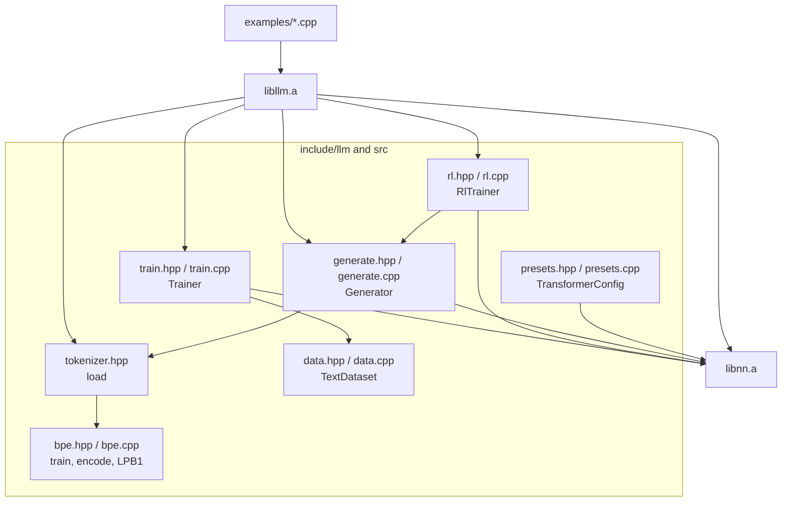
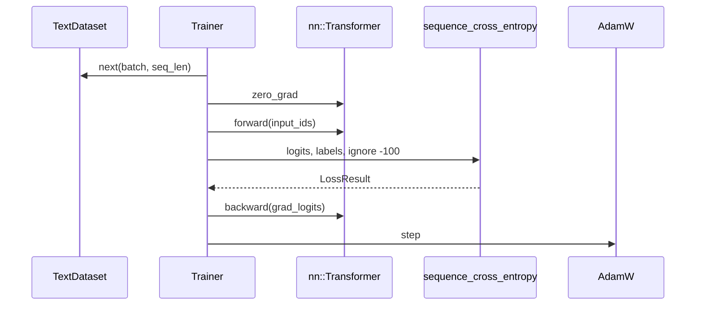
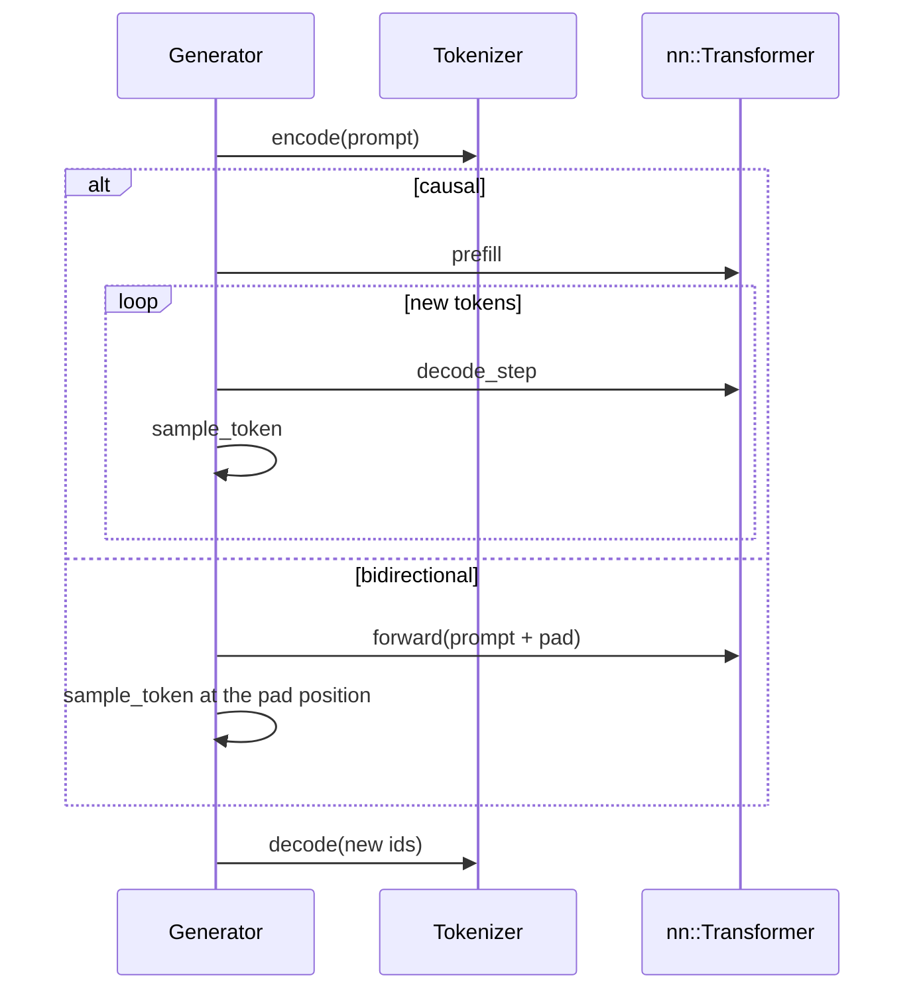

# Code structure

`llm` is the text, the presets, and the training loop. `nn` is the tensors, the layers, the transformer, the loss, and AdamW. Public headers under `include/llm/` do not include CUDA, HIP, OpenCL, Metal, or SYCL headers. The static library `llm` links the CMake target `nn` and pthread.

`./build.sh` selects the sibling that supplies `nn`. The marker is a file in that sibling:

| Command | Sibling | Marker |
|---|---|---|
| `./build.sh cuda` | `../nnCUDA` | none of the files below |
| `./build.sh opencl` | `../nnCL` | `src/kernels.cl` |
| `./build.sh amd` | `../nnROCm` | `src/elementwise.hip` |
| `./build.sh arc` | `../nnArc` | `src/elementwise.cpp` |
| `./build.sh agx` | `../nnAGX` | `src/kernels.metal` |

`add_subdirectory` builds that sibling as `nn_build` with `EXCLUDE_FROM_ALL`, so its tests stay out of this project's `all`. The code structure of `nn` is in that sibling's `docs/code-structure.md`.

## Modules

`BpeTokenizer` trains and loads `LPB1`. `HfTokenizer` loads a Hugging Face `tokenizer.json` byte-level BPE. `Tokenizer::load` reads an LPB1 file. `Tokenizer::load_directory` reads the selected tokenizer from a model directory. Token ids stay on the host until `TextDataset::next` uploads an `nn::IndexTensor`.

| Header | Source | Owns |
|---|---|---|
| `include/llm/tokenizer.hpp` | `Tokenizer::load` is implemented in `src/bpe.cpp` | The abstract tokenizer and `EncodeOptions` |
| `include/llm/chat_template.hpp` | inline in the header | `ChatWrap` and the dialogue, plain, and ChatML prompt helpers |
| `include/llm/bpe.hpp` | `src/bpe.cpp` | Byte-level BPE, merges, and the `LPB1` file |
| `include/llm/hf_tokenizer.hpp` | `src/hf_tokenizer.cpp` | Hugging Face `tokenizer.json` byte-level BPE |
| `include/llm/data.hpp` | `src/data.cpp` | `tokens.bin`, `tokens.meta`, and next-token batches |
| `include/llm/presets.hpp` | `src/presets.cpp` | Preset `nn::TransformerConfig` values and `adamw_groups` |
| `include/llm/train.hpp` | `src/train.cpp` | `learning_rate_at` and `Trainer::fit` |
| `include/llm/rl.hpp` | `src/rl.cpp` | Host `policy_gradient` and `RlTrainer::fit` |
| `include/llm/generate.hpp` | `src/generate.cpp` | `sample_token` and `Generator::generate` |

`presets.cpp` fills a config. It does not construct a `Transformer`. The caller passes that config to `nn::Transformer`.

## A training step

`Trainer` borrows a `Context`, a `Transformer`, and an `AdamW`. One step reads a batch, runs the trunk, and steps AdamW.

`fit` repeats that step for `max_steps`. Micro-batches scale the gradient by `1 / grad_accum_steps` before one clip and one `step`. A positive `early_stop_patience` restores the best step, including AdamW moments. A finite `min_loss` of at least 0 keeps the step that reached it. `checkpoint_path` is `Transformer::save` with the AdamW pointer. When `masked_lm` is set, the labels are the original ids at the chosen positions and `-100` elsewhere.

## Generation

`Generator` borrows the same kind of context and model, plus a `Tokenizer`. A causal config prefills the KV cache and samples with `decode_step`. A bidirectional config appends the pad id and reads that position from `forward`.

`sample_token` runs on the host. Temperature 0 is the argmax. Otherwise the logits are divided by temperature, cut to `top_k` when that value is positive, softmaxed, and nucleus-filtered when `top_p` is below 1.

## Reinforcement learning

`RlTrainer` samples a group of completions from a causal policy, scores them with the caller's reward function, and applies the host policy gradient. `group_size` above 1 uses the reward minus the group mean as the advantage. `kl_coef` above 0 reads a frozen reference `Transformer` that `fit` does not train. `policy_gradient` matches `sequence_cross_entropy` when every advantage is 1 and `kl_coef` is 0.

## Examples and tests

The examples are separate executables. They link `llm`. They are not part of `libllm.a`.

| Target | Source | Role |
|---|---|---|
| `llm_tests` | `tests/test_bpe.cpp`, `test_hf_tokenizer.cpp`, `test_data.cpp`, `test_train.cpp`, `test_rl.cpp` | Tokenizer, Hugging Face tokenizer, ChatML wrap, dataset, presets, trainer, generator, policy gradient |
| `train_tiny` | `examples/train_tiny.cpp` | Acceptance train of `presets::tiny` |
| `train_bench` | `examples/train_bench.cpp` | Time eight steps of `presets::tiny` |
| `train_chat` | `examples/train_chat.cpp` | Train `tiny` and `bert_tiny` on one dialogue tokenizer |
| `train_bert_chat` | `examples/train_bert_chat.cpp` | Train `bert_tiny` and print one reply |
| `train_data` | `examples/train_data.cpp` | Train a preset from files, a directory, or stdin |
| `chat` | `examples/chat.cpp` | Continue a transcript, a plain prompt, or a ChatML prompt |
| `finetune` | `examples/finetune.cpp` | Keep training a checkpoint on a new file list |
| `reinforce` | `examples/reinforce.cpp` | Update a causal checkpoint from a string reward |
| `gguf` | `examples/gguf.cpp` | Convert `model.bin` and GGUF files |
| `hf` | `examples/hf.cpp` | Convert a Hugging Face snapshot to `model.bin` |

`gguf` and `hf` read and write checkpoint bytes themselves. They do not go through `Trainer`. On a CUDA build, `llm_tests` defines `LLM_NN_CUDA` and reads an `IndexTensor` with `cudaMemcpy`. The OpenCL, ROCm, Arc, and AGX builds use `IndexTensor::to_host()`.

See also:

- [README.md](../README.md) — build and the preset table
- [USAGE.md](../USAGE.md) — call sequences and file layouts
- [glossary.md](glossary.md) — names used in these modules
