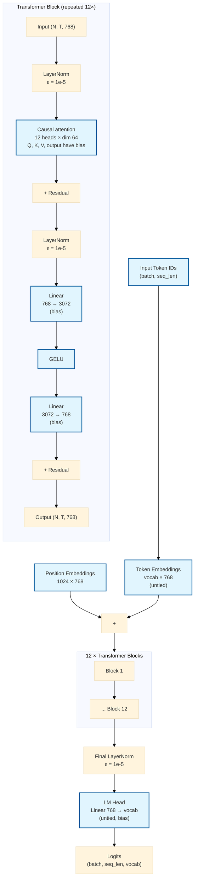

# gpt2-base Architecture

The `gpt2_base` preset in the `llm` library (`llm::presets::gpt2_base`) defines a decoder-only Transformer with the GPT-2 block: learned absolute positions, pre-norm LayerNorm, causal attention, and a GELU MLP of width `4 * d_model`.

## Specs

| Spec | Value |
|------|-------|
| Layers (`num_layers`) | 12 |
| Model dimension (`d_model`) | 768 |
| Attention heads (`num_heads`) | 12 (head dim = 64) |
| Feed-forward intermediate (`d_ff`) | 3072 (GELU; fc1 writes 3072, not 6144) |
| Max sequence length | 1024 |
| Positional encoding | learned absolute (`pos_emb`, 1024 × 768) |
| Normalization | LayerNorm, epsilon `1e-5` |
| Activation | GELU, the erf form (`0.5 * x * (1 + erf(x / sqrt(2)))`), not the tanh approximation |
| Bias | true, on Q, K, V, the attention output, both MLP linears, and the LM head |
| Tie embeddings | false (`nn` rejects `tie_embeddings`; OpenAI ties `wte` to the LM head) |
| Dropout | 0 (OpenAI trained GPT-2 with dropout 0.1; every preset in this library uses 0) |
| Parameter count (untied, vocab ≈ 16000) | 110,434,432 (~110.43 M) |

These match the values returned by `llm::presets::gpt2_base(vocab_size)` and the counts documented in the README / USAGE.md. `gpt2_tiny` is 4 × 256 with `d_ff` 1024. `gpt2_small` is 6 × 512 with `d_ff` 2048. Both keep context 1024. `train_books --preset gpt2-base` trains this shape and saves a version-2 checkpoint.

This is the block to train. It does not load OpenAI's GPT-2 weights. `gguf from` still rejects a public GPT-2 GGUF, and `gguf llama` rejects a checkpoint that uses GELU or linear bias. An nnllm GGUF keeps both.

## Architecture Diagram

The diagram shows the data flow for a forward pass. Token embeddings and learned position embeddings are added, then each of the 12 identical blocks applies pre-norm LayerNorm → causal attention → residual, then pre-norm LayerNorm → GELU MLP → residual. There is no RoPE and no RMSNorm. Embeddings are not tied to the LM head.

See also:

- [README.md](../README.md) — preset table and parameter counts
- [USAGE.md](../USAGE.md) — full programmer notes
- [gpt3-base-architecture.md](gpt3-base-architecture.md) — the same block with context 2048
- [bert-base-architecture.md](bert-base-architecture.md) — the same dense block with bidirectional attention and context 512
- `include/llm/presets.hpp` / `src/presets.cpp` — source of the config
