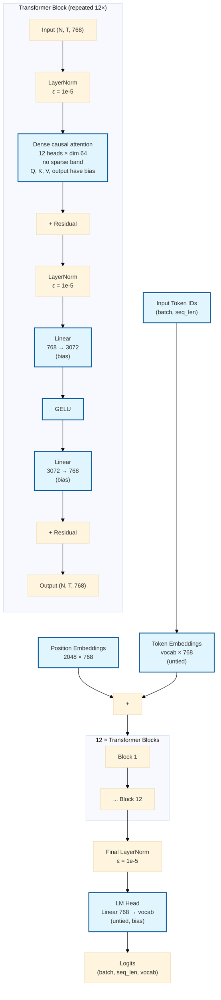

# gpt3-base Architecture

The `gpt3_base` preset in the `llm` library (`llm::presets::gpt3_base`) defines the same dense decoder as `gpt2_base`, with `max_seq_len` 2048.

The GPT-3 paper uses the GPT-2 block except for alternating dense and locally banded sparse attention, and it trains at context 2048. This library has no sparse attention. `gpt3_*` is the dense GPT-2 block at that context length: learned absolute positions, pre-norm LayerNorm, causal attention, GELU, and `d_ff = 4 * d_model`.

## Specs

| Spec | Value |
|------|-------|
| Layers (`num_layers`) | 12 |
| Model dimension (`d_model`) | 768 |
| Attention heads (`num_heads`) | 12 (head dim = 64) |
| Feed-forward intermediate (`d_ff`) | 3072 (GELU; fc1 writes 3072, not 6144) |
| Max sequence length | 2048 |
| Positional encoding | learned absolute (`pos_emb`, 2048 × 768) |
| Normalization | LayerNorm, epsilon `1e-5` |
| Activation | GELU, the erf form, not the tanh approximation |
| Bias | true, on Q, K, V, the attention output, both MLP linears, and the LM head |
| Tie embeddings | false (`nn` rejects `tie_embeddings`) |
| Dropout | 0 |
| Sparse attention | not implemented; every layer is dense causal attention |
| Parameter count (untied, vocab ≈ 16000) | 111,220,864 (~111.22 M) |

These match the values returned by `llm::presets::gpt3_base(vocab_size)` and the counts documented in the README / USAGE.md. The only extra parameters versus `gpt2_base` are the longer position table: `2048 * 768 - 1024 * 768 = 786432`. `gpt3_tiny` is 4 × 256 with `d_ff` 1024. `gpt3_small` is 6 × 512 with `d_ff` 2048. `train_books --preset gpt3-base` trains this shape and saves a version-2 checkpoint.

`--seq-len` may be as large as 2048. Attention memory grows with that length. On a 12 GB GPU prefer 512 or below for this width, the same rule as `base`.

This preset does not load GPT-3 weights. OpenAI did not release them. `gguf llama` rejects the checkpoint because of GELU and linear bias. An nnllm GGUF keeps both.

## Architecture Diagram

The diagram shows the data flow for a forward pass. It is the `gpt2_base` block with a 2048-row position table. Every attention layer is dense. There is no alternating locally banded pattern.

See also:

- [README.md](../README.md) — preset table and parameter counts
- [USAGE.md](../USAGE.md) — full programmer notes
- [gpt2-base-architecture.md](gpt2-base-architecture.md) — the same block with context 1024
- `include/llm/presets.hpp` / `src/presets.cpp` — source of the config
