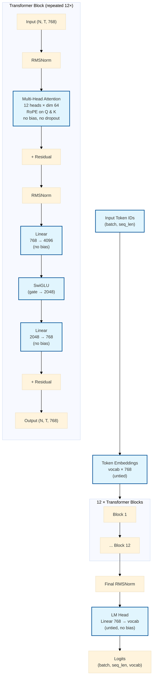

# llama-base Architecture

The `llama_base` preset in the `llm` library (`llm::presets::llama_base`) defines a decoder-only Transformer with RoPE and RMSNorm, matching the Llama-style block used by the library.

## Specs

| Spec | Value |
|------|-------|
| Layers (`num_layers`) | 12 |
| Model dimension (`d_model`) | 768 |
| Attention heads (`num_heads`) | 12 (head dim = 64) |
| Feed-forward intermediate (`d_ff`) | 2048 (SwiGLU; fc1 expands to 4096) |
| Max sequence length | 1024 |
| Positional encoding | RoPE (adjacent-pair, base 10000) |
| Normalization | RMSNorm |
| Activation | SwiGLU |
| Bias | false |
| Tie embeddings | false |
| Dropout | 0 |
| Parameter count (untied, vocab ≈ 16000) | 109,529,856 (~109.53 M) |

These match the values returned by `llm::presets::llama_base(vocab_size)` and the counts documented in the README / USAGE.md.

## Architecture Diagram

The diagram shows the data flow for a forward pass. Each of the 12 identical blocks applies pre-norm RMSNorm → attention (with RoPE) → residual, then pre-norm RMSNorm → SwiGLU FFN → residual. There is no learned absolute position table (those parameters are omitted compared with the non-llama `base` preset). All linear layers are bias-free, and embeddings are not tied to the LM head.

See also:
- [README.md](../README.md) — preset table and parameter counts
- [USAGE.md](../USAGE.md) — full programmer notes
- `include/llm/presets.hpp` / `src/presets.cpp` — source of the config
