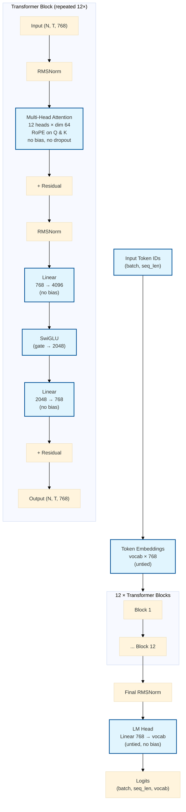
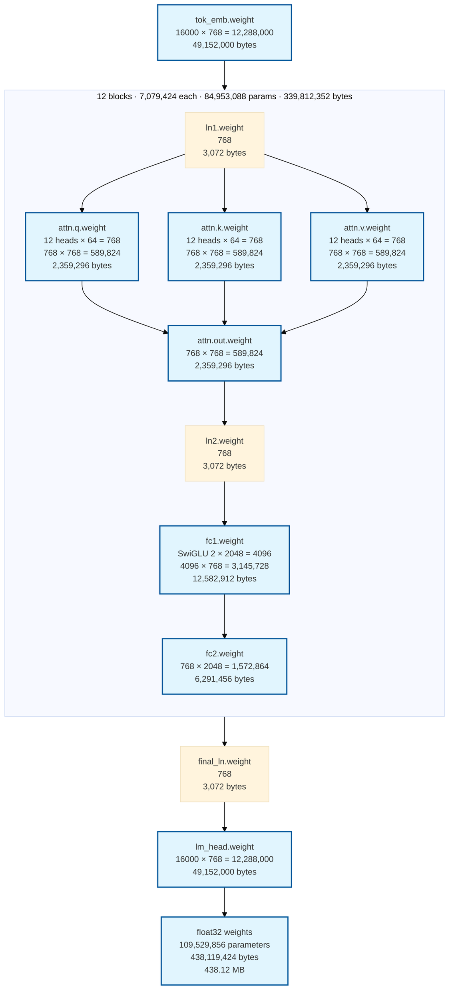

# llama-base Architecture

The `llama_base` preset in the `llm` library (`llm::presets::llama_base`) defines a decoder-only Transformer with RoPE and RMSNorm, matching the Llama-style block used by the library.

## Specs

| Spec | Value |
|------|-------|
| Layers (`num_layers`) | 12 |
| Model dimension (`d_model`) | 768 |
| Attention heads (`num_heads`) | 12 (head dim = 64) |
| Feed-forward intermediate (`d_ff`) | 2048 (SwiGLU; fc1 expands to 4096) |
| Max sequence length | 1024 |
| Positional encoding | RoPE (adjacent-pair, base 10000) |
| Normalization | RMSNorm |
| Activation | SwiGLU |
| Bias | false |
| Tie embeddings | false |
| Dropout | 0 |
| Parameter count (untied, vocab ≈ 16000) | 109,529,856 (~109.53 M) |

These match the values returned by `llm::presets::llama_base(vocab_size)` and the counts documented in the README / USAGE.md.

## Architecture Diagram

The diagram shows the data flow for a forward pass. Each of the 12 identical blocks applies pre-norm RMSNorm → attention (with RoPE) → residual, then pre-norm RMSNorm → SwiGLU FFN → residual. There is no learned absolute position table (those parameters are omitted compared with the non-llama `base` preset). All linear layers are bias-free, and embeddings are not tied to the LM head.

## Layer and head footprint

Each weight is float32, so each parameter is four bytes. The vocab in this count is 16000, the same vocab as the README Size column. Activations and Adam moments are not drawn.

One block is `768 + 4 × 589,824 + 768 + 3,145,728 + 1,572,864 = 7,079,424` parameters. Twelve blocks are 84,953,088. The token table and the LM head are 12,288,000 each, and the final RMSNorm is 768. The sum is 109,529,856 parameters, 438,119,424 bytes, 438.12 MB. Query, key, and value each hold 12 heads of dimension 64, so each of those matrices is square in `d_model`. RoPE stores no table.

See also:
- [preset-llama.md](preset-llama.md) — usage, benefits, and applications
- [README.md](../README.md) — preset table and parameter counts
- [USAGE.md](../USAGE.md) — full programmer notes
- `include/llm/presets.hpp` / `src/presets.cpp` — source of the config
