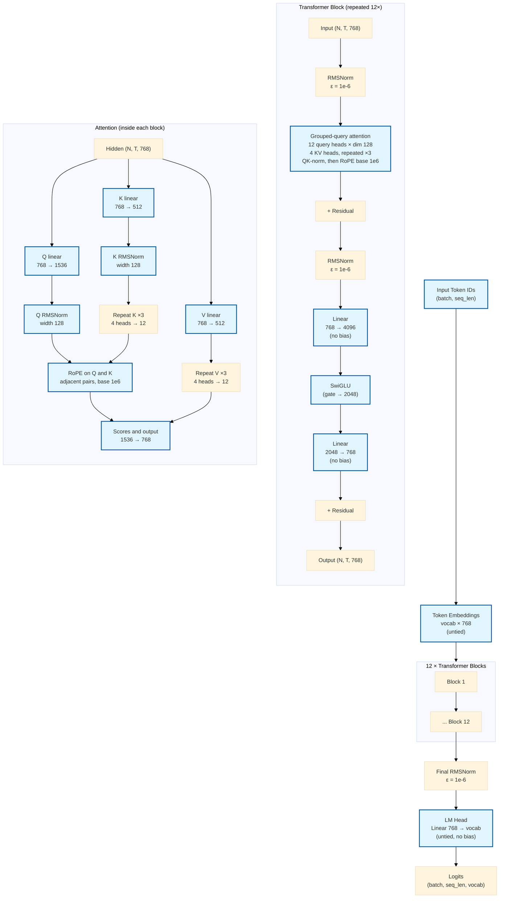

# qwen-base Architecture

The `qwen_base` preset in the `llm` library (`llm::presets::qwen_base`) defines a decoder-only Transformer with the Qwen3 block: grouped-query attention, head dim 128, QK-norm, RoPE base `1e6`, and RMSNorm epsilon `1e-6`.

## Specs

| Spec | Value |
|------|-------|
| Layers (`num_layers`) | 12 |
| Model dimension (`d_model`) | 768 |
| Query heads (`num_heads`) | 12 |
| KV heads (`num_kv_heads`) | 4 (each repeated ×3) |
| Head dim (`head_dim`) | 128 |
| Q projection | 768 → 1536 (`12 × 128`) |
| K and V projections | 768 → 512 (`4 × 128`) |
| Output projection | 1536 → 768 |
| QK-norm | RMSNorm, width 128, epsilon `1e-6`, before RoPE |
| Feed-forward intermediate (`d_ff`) | 2048 (SwiGLU; fc1 expands to 4096) |
| Max sequence length | 1024 |
| Positional encoding | RoPE (adjacent-pair, base `1e6`) |
| Normalization | RMSNorm, epsilon `1e-6` |
| Activation | SwiGLU |
| Bias | false |
| Tie embeddings | false |
| Dropout | 0 |
| Parameter count (untied, vocab ≈ 16000) | 118,970,112 (~118.97 M) |

These match the values returned by `llm::presets::qwen_base(vocab_size)` and the counts documented in the README / USAGE.md. `train_books --preset qwen-base` trains this shape and saves a version-4 checkpoint.

## Architecture Diagram

The diagram shows the data flow for a forward pass. Each of the 12 identical blocks applies pre-norm RMSNorm → attention → residual, then pre-norm RMSNorm → SwiGLU FFN → residual. Inside attention the order is the Q, K, and V linears, a split into heads, RMSNorm on Q and on K, a repeat of each KV head across the three query heads in its group, RoPE on Q and on the repeated K, then the output projection. Positions come from that RoPE, so the checkpoint has no position table. All linear layers are bias-free, and embeddings are not tied to the LM head.

See also:
- [README.md](../README.md) — preset table and parameter counts
- [USAGE.md](../USAGE.md) — full programmer notes
- [llama-base-architecture.md](llama-base-architecture.md) — the same width with square heads and RoPE base 10000
- `include/llm/presets.hpp` / `src/presets.cpp` — source of the config
