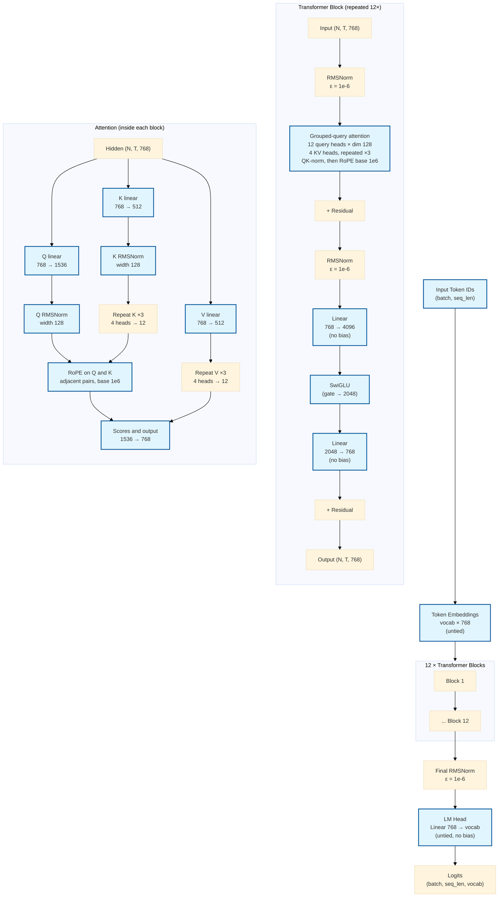
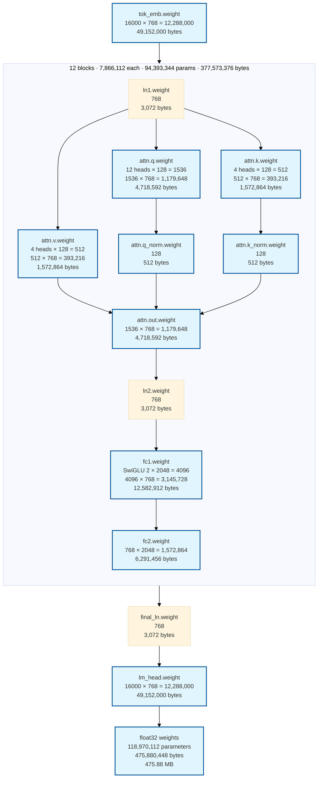

# qwen-base Architecture

The `qwen_base` preset in the `llm` library (`llm::presets::qwen_base`) defines a decoder-only Transformer with the Qwen3 block: grouped-query attention, head dim 128, QK-norm, RoPE base `1e6`, and RMSNorm epsilon `1e-6`.

## Specs

| Spec | Value |
|------|-------|
| Layers (`num_layers`) | 12 |
| Model dimension (`d_model`) | 768 |
| Query heads (`num_heads`) | 12 |
| KV heads (`num_kv_heads`) | 4 (each repeated ×3) |
| Head dim (`head_dim`) | 128 |
| Q projection | 768 → 1536 (`12 × 128`) |
| K and V projections | 768 → 512 (`4 × 128`) |
| Output projection | 1536 → 768 |
| QK-norm | RMSNorm, width 128, epsilon `1e-6`, before RoPE |
| Feed-forward intermediate (`d_ff`) | 2048 (SwiGLU; fc1 expands to 4096) |
| Max sequence length | 1024 |
| Positional encoding | RoPE (adjacent-pair, base `1e6`) |
| Normalization | RMSNorm, epsilon `1e-6` |
| Activation | SwiGLU |
| Bias | false |
| Tie embeddings | false |
| Dropout | 0 |
| Parameter count (untied, vocab ≈ 16000) | 118,970,112 (~118.97 M) |

These match the values returned by `llm::presets::qwen_base(vocab_size)` and the counts documented in the README / USAGE.md. `train_data --preset qwen-base` trains this shape and saves a version-4 checkpoint.

## Architecture Diagram

The diagram shows the data flow for a forward pass. Each of the 12 identical blocks applies pre-norm RMSNorm → attention → residual, then pre-norm RMSNorm → SwiGLU FFN → residual. Inside attention the order is the Q, K, and V linears, a split into heads, RMSNorm on Q and on K, a repeat of each KV head across the three query heads in its group, RoPE on Q and on the repeated K, then the output projection. Positions come from that RoPE, so the checkpoint has no position table. All linear layers are bias-free, and embeddings are not tied to the LM head.

## Layer and head footprint

Each weight is float32, so each parameter is four bytes. The vocab in this count is 16000, the same vocab as the README Size column. Activations and Adam moments are not drawn. Repeating a KV head across its three query heads adds no weights.

One block is `768 + 1,179,648 + 2 × 393,216 + 1,179,648 + 128 + 128 + 768 + 3,145,728 + 1,572,864 = 7,866,112` parameters. Twelve blocks are 94,393,344. The token table and the LM head are 12,288,000 each, and the final RMSNorm is 768. The sum is 118,970,112 parameters, 475,880,448 bytes, 475.88 MB. Q is wider than `d_model` because each of the 12 heads has dimension 128. K and V stay at 4 heads of that same dimension.

See also:
- [preset-qwen.md](preset-qwen.md) — usage, benefits, and applications
- [README.md](../README.md) — preset table and parameter counts
- [USAGE.md](../USAGE.md) — full programmer notes
- [llama-base-architecture.md](llama-base-architecture.md) — the same width with square heads and RoPE base 10000
- `include/llm/presets.hpp` / `src/presets.cpp` — source of the config
